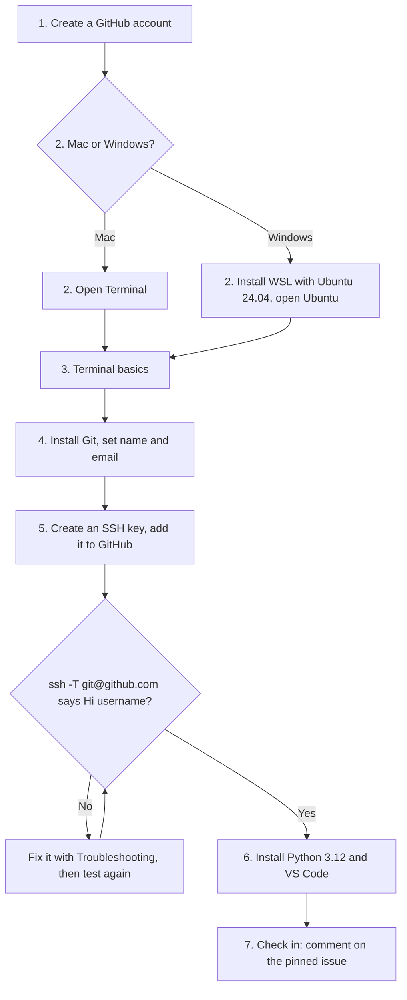

# Session 0: Set up your computer before Session 1

Session 0 is **required** and **self-paced**. You do it at home, before the course starts, and it adds no classroom hours. Finish it by the check-in deadline: **3 days before Session 1**. Your instructor will send you the exact date.

By the end you will have a GitHub account, a working terminal, Git, an SSH connection to GitHub, Python 3.12 and VS Code. You will then prove it works by posting one comment on a shared check-in page.

Session 0 does **not** teach `commit` or `push`. You will learn those in Session 1.

You do not need any terminal experience. Follow the steps in order. Every step has the same four parts:

1. **What you'll do**: the goal of the step.
2. **Commands**: text to copy and paste.
3. **What you should see**: how to tell it worked.
4. **If it fails**: what to try next.

## The whole setup at a glance



Jump to a step:

| Step | Mac | Windows |
| --- | --- | --- |
| 1. Create a GitHub account | [Step 1](#step-1-create-a-github-account) | [Step 1](#step-1-create-a-github-account) |
| 2. Open a terminal | [Step 2 (Mac)](#step-2-mac-open-terminal) | [Step 2 (Windows)](#step-2-windows-install-wsl-and-open-ubuntu) |
| 3. Terminal basics | [Step 3](#step-3-terminal-basics) | [Step 3](#step-3-terminal-basics) |
| 4. Install Git | [Step 4 (Mac)](#step-4-mac-install-git-and-set-your-name-and-email) | [Step 4 (Windows)](#step-4-windows-install-git-and-set-your-name-and-email) |
| 5. SSH key | [Step 5 (Mac)](#step-5-mac-create-an-ssh-key-and-add-it-to-github) | [Step 5 (Windows)](#step-5-windows-create-an-ssh-key-and-add-it-to-github) |
| 6. Python and VS Code | [Step 6 (Mac)](#step-6-mac-install-python-312-and-vs-code) | [Step 6 (Windows)](#step-6-windows-install-python-312-and-vs-code) |
| 7. Check in | [Step 7](#step-7-check-in) | [Step 7](#step-7-check-in) |

**Linux users:** use your own terminal and your distribution's package manager for Git and Python 3.12, then follow the Mac steps for the SSH key (Step 5), skipping the `UseKeychain` line, and do Step 7. You do not need WSL.

**Windows users:** the whole course runs inside WSL (Windows Subsystem for Linux). From Step 2 on, every command in this course is typed in the **Ubuntu** window, never in PowerShell or Command Prompt.

## Step 1: Create a GitHub account

**What you'll do.** Make a free GitHub account. If you already have one, sign in and skip to Step 2.

**Steps.**

1. Go to <https://github.com/signup>.
2. Enter your email, a password and a username. Confirm your email address when GitHub sends you a message.

**Choosing a username.** Your username is public and appears on everything you do, including the check-in comment and later your group's work. Pick one you would be happy to show an employer: your name, or a version of it, such as `jane-chen` or `janechen-stats`. Avoid jokes, birth years and anything you would not put on a CV.

**What you should see.** After signing in, GitHub shows your dashboard, and your username appears when you click your profile picture at the top right.

**If it fails.** If your preferred username is taken, GitHub suggests alternatives; add your initials or a hyphen. If the confirmation email does not arrive, check your spam folder, then use **Resend** on the GitHub page.

## Step 2 (Mac): Open Terminal

**What you'll do.** Open the Terminal app, where you will type every command in this course.

**Steps.** Press `Command` + `Space`, type `Terminal`, then press `Return`.

**What you should see.** A window with a line ending in `%`. This is the prompt. It is waiting for you to type.

**If it fails.** Open Finder, choose **Applications → Utilities → Terminal**.

## Step 2 (Windows): Install WSL and open Ubuntu

**What you'll do.** Install WSL 2 (Windows Subsystem for Linux) with **Ubuntu 24.04 LTS**. WSL 2 gives you a real Linux terminal inside Windows, so you type exactly the same commands as every Mac student. This is the only step where you use PowerShell.

**Before you start.** You need Windows 10 version 2004 or later (build 19041+), or Windows 11. To check, press `Windows` + `R`, type `winver` and press `Enter`. Your computer must also have virtualization turned on; it usually is. If the install fails, see [Troubleshooting](#troubleshooting).

**Steps and commands.**

1. Click Start, type `PowerShell`, right-click **Windows PowerShell** and choose **Run as administrator**. Click **Yes**.
2. Paste this command and press `Enter`. It turns on the Windows features WSL 2 needs, installs the Linux kernel and downloads Ubuntu 24.04. This can take several minutes.

   ```text
   wsl --install -d Ubuntu-24.04
   ```

3. **Restart your computer** when asked (or if the command says a restart is required).
4. After the restart, **Ubuntu 24.04 LTS** opens by itself. If it does not, open it from the Start menu. Wait for "Installing, this may take a few minutes", then choose a **username** (lowercase, no spaces) and a **password** when asked. These are only for this Ubuntu and are unrelated to GitHub. When you type the password nothing appears on screen; that is normal. Remember it: you will need it for `sudo`.
5. Make sure the installation is WSL 2. Open PowerShell again (a normal window is fine) and run:

   ```text
   wsl --list --verbose
   ```

   The row for `Ubuntu-24.04` should show `VERSION` **2**. If it shows `1`, convert it and make 2 the default:

   ```text
   wsl --set-default-version 2
   wsl --set-version Ubuntu-24.04 2
   ```

6. Close PowerShell. **From now on, use only the Ubuntu window** for every course command. To open it later, click Start, type `Ubuntu 24.04` and press `Enter`.

**What you should see.** A window with a prompt like `jane@DESKTOP-ABC123:~$`. Check the version:

```bash
lsb_release -d
```

It prints `Description: Ubuntu 24.04.x LTS`.

**If it fails.** See [Troubleshooting](#troubleshooting) in Troubleshooting. If `wsl` is not recognized, update Windows (Settings → Windows Update) and try again. If the version printed is not 24.04, ask for help in a reply on your check-in comment before continuing.

Mac and Linux users skip this step.

## Step 3: Terminal basics

**What you'll do.** Learn five things: where you are, what is here, how to move, how to make a folder, and how to copy and paste. Everything later uses these.

**Commands.** Type each line, then press `Return`. Lines starting with `#` are comments for you to read; you do not need to type them.

```bash
pwd
ls
mkdir 3r-practice
cd 3r-practice
pwd
cd ..
```

- `pwd` prints the folder you are in ("print working directory").
- `ls` lists what is in this folder.
- `mkdir NAME` makes a new folder called `NAME`.
- `cd NAME` moves into the folder `NAME`. `cd ..` moves back up one level.

**Copy and paste.** In the Mac Terminal, copy with `Command` + `C` and paste with `Command` + `V`. In the Ubuntu window on Windows, select text and right-click to copy, then right-click on an empty spot to paste (or use `Ctrl` + `Shift` + `C` and `Ctrl` + `Shift` + `V`). Do not type long commands by hand; paste them.

**What you should see.** The first `pwd` prints something like `/Users/jane`. After `cd 3r-practice`, the second `pwd` ends with `/3r-practice`. `ls` shows the new folder `3r-practice` the next time you run it from the folder above.

**If it fails.** If you see `No such file or directory`, you are probably in a different folder than you think; run `pwd`, then `cd ~` to return to your home folder and try again. If you see `File exists`, the folder already exists; skip `mkdir`.

## Step 4 (Mac): Install Git and set your name and email

**What you'll do.** Install Git with Apple's developer tools, then tell Git who you are so your future work carries your name.

**Commands.**

```bash
xcode-select --install
```

A window asks whether to install the command line developer tools. Click **Install**, accept the license and wait for it to finish (it can take several minutes). Then check:

```bash
git --version
```

Now set your name and the email you used for GitHub. Replace the text in quotes with your own.

```bash
git config --global user.name "Jane Chen"
git config --global user.email "jane@example.com"
git config --global --list
```

**What you should see.** `git --version` prints something like `git version 2.39.5 (Apple Git-154)`. The last command lists `user.name` and `user.email` with your values.

**If it fails.** If `xcode-select --install` says `command line tools are already installed`, you are done with the install; run `git --version`. If the install window never appears or stalls, restart the Mac and run the command again. If you mistyped your name or email, run the `git config` line again with the correct text.

## Step 4 (Windows): Install Git and set your name and email

The Windows steps are being added; they will appear here before the course starts.

## Step 5 (Mac): Create an SSH key and add it to GitHub

**What you'll do.** An SSH key is a pair of files that lets GitHub recognize your computer without a password. The **private key** stays on your computer and is secret. The **public key** goes to GitHub.

> **Never share your private key.** It is the file named `id_ed25519` with no ending. Never paste it anywhere: not in the check-in, not in a chat, not in an email. The file you share is `id_ed25519.pub`, the one ending in `.pub`.

### 5a. Create the key

Replace the email with the one you used for GitHub.

```bash
ssh-keygen -t ed25519 -C "jane@example.com"
```

Press `Return` to accept the default file location. When asked for a passphrase you may press `Return` twice for none, or choose one you will remember.

Then let your Mac remember the key:

```bash
eval "$(ssh-agent -s)"
mkdir -p ~/.ssh
cat >> ~/.ssh/config <<'EOF'
Host github.com
  AddKeysToAgent yes
  UseKeychain yes
  IdentityFile ~/.ssh/id_ed25519
EOF
ssh-add --apple-use-keychain ~/.ssh/id_ed25519
```

**What you should see.** `ssh-keygen` prints "Your public key has been saved in /Users/jane/.ssh/id_ed25519.pub" and a small picture made of characters. `ssh-add` prints `Identity added`.

### 5b. Add the public key to GitHub

Copy your public key to the clipboard:

```bash
pbcopy < ~/.ssh/id_ed25519.pub
```

Then in your browser:

1. Sign in to GitHub, click your profile picture, and choose **Settings**.
2. Choose **SSH and GPG keys**, then **New SSH key**.
3. Give it a **Title** such as `My Mac`, leave **Key type** as **Authentication Key**, and paste into the **Key** box (`Command` + `V`).
4. Click **Add SSH key**. GitHub may ask for your password.

**What you should see.** Your key listed under **SSH keys**, with the title you chose.

### 5c. Test the connection

```bash
ssh -T git@github.com
```

The first time, the terminal shows a message like this and asks a question:

```text
The authenticity of host 'github.com (140.82.112.3)' can't be established.
ED25519 key fingerprint is SHA256:+DiY3wvvV6TuJJhbpZisF/zLDA0zPMSvHdkr4UvCOqU.
Are you sure you want to continue connecting (yes/no/[fingerprint])?
```

This is your computer meeting GitHub for the first time. Check that the line after `ED25519 key fingerprint is` matches the one above (it is also published on [GitHub's documentation](https://docs.github.com/en/authentication/keeping-your-account-and-data-secure/githubs-ssh-key-fingerprints)), then type `yes` and press `Return`. If it does not match, answer `no`.

**What you should see.**

```text
Hi your-username! You've successfully authenticated, but GitHub does not provide shell access.
```

That message is a success, even though it sounds like a refusal. Your username appears in place of `your-username`.

**If it fails.** Look at the last line of the output.

- `Permission denied (publickey).`: GitHub does not recognize your key. Check that you added the `.pub` file's contents in 5b, then run `ssh-add --apple-use-keychain ~/.ssh/id_ed25519` and test again.
- `Connection timed out` or `Connection refused`: a network (often a campus or office network) may block SSH. Try a different network, such as your phone's hotspot, and test again.
- Anything else: copy the whole output into a reply on your check-in comment (Step 7) and ask for help. Do not paste your private key.

Repeat the test until you see the `Hi ...` message, then continue.

## Step 5 (Windows): Create an SSH key and add it to GitHub

The Windows steps are being added; they will appear here before the course starts.

## Step 6 (Mac): Install Python 3.12 and VS Code

**What you'll do.** Install Python 3.12, the language of the course, and VS Code, the editor you will use for course files.

**Steps.**

1. Open <https://www.python.org/downloads/> and find the latest **Python 3.12.x** release (use the **Looking for a specific release?** list if the front page shows a newer version). Download the **macOS 64-bit universal2 installer**.
2. Open the downloaded `.pkg` file and click through the installer with the default choices.
3. Download VS Code from <https://code.visualstudio.com/>, open the download, and drag **Visual Studio Code** into your **Applications** folder.

**Commands.** Open a new Terminal window (so it sees the new install), then run:

```bash
python3.12 --version
```

**What you should see.** `Python 3.12.` followed by a number, for example `Python 3.12.8`. VS Code opens from the Applications folder.

**If it fails.** If you see `command not found: python3.12`, close Terminal completely, open it again and retry. If it still fails, rerun the installer and make sure it finished without errors. If macOS says VS Code "cannot be opened because it is from an unidentified developer", open **System Settings → Privacy & Security** and click **Open Anyway**.

## Step 6 (Windows): Install Python 3.12 and VS Code

The Windows steps are being added; they will appear here before the course starts.

## Step 7: Check in

**What you'll do.** Show that your setup works by posting one comment on the shared **Session 0 check-in** issue in the course sandbox. This is how your instructor knows you are ready, and it is also how they learn your GitHub username.

**Commands.** Run these three commands and copy all the output:

```bash
git --version
python3.12 --version
ssh -T git@github.com
```

**What to post.** Open the pinned **Session 0 check-in** issue in the [3R-sandbox repository](https://github.com/drweihungpan-lab/3R-sandbox/issues), scroll to the comment box at the bottom, and paste the output of **those three commands**, nothing else. A good comment looks like this:

```text
git version 2.39.5 (Apple Git-154)
Python 3.12.8
Hi jane-chen! You've successfully authenticated, but GitHub does not provide shell access.
```

> **Never paste a private key, a password or a token.** The three commands above never print one. If any output shows something you do not recognize or would not want public, leave it out and ask for help instead. The sandbox is public.

Comment on the existing issue; do **not** open a new issue. If you rerun the check later, edit your own comment instead of posting again. You do not need to push or change any files.

**What you should see.** Your comment appears under the issue with your username.

**If it fails.** If you cannot sign in or comment, check that you are signed in to GitHub and that you confirmed your email address (Step 1). If one of the three commands fails, go back to its step. If you are stuck, reply under your own check-in comment describing what you see, and your instructor will respond. Do this well before the deadline so there is time to fix it.

## Troubleshooting

Troubleshooting entries for both platforms are being added; for now use the **If it fails** part of each step.

## What comes next

In Session 1 you will use the same SSH connection to copy a repository to your computer and begin working with Git. Keep your terminal, your SSH key and your GitHub account as they are.
